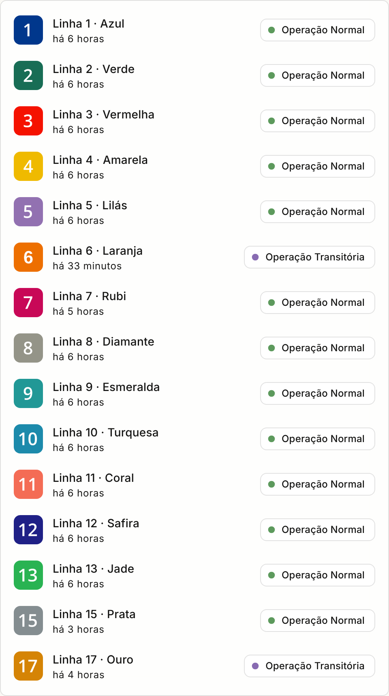

# Metrô SP

<!-- ha-marketplace:exclude-start -->
[](https://github.com/roquerodrigo/ha-metro-sp/actions/workflows/ci.yml)
[](https://github.com/roquerodrigo/ha-metro-sp/releases/latest)
[](https://github.com/sponsors/roquerodrigo)

[](https://my.home-assistant.io/redirect/hacs_repository/?owner=roquerodrigo&repository=ha-metro-sp&category=integration)
<!-- ha-marketplace:exclude-end -->

Saiba se a sua linha do Metrô ou da CPTM está funcionando antes de sair de
casa. O Home Assistant mostra a situação de cada linha da rede metroferroviária
de São Paulo, com o texto da ocorrência quando há problema, e atualiza tudo a
cada minuto. Os dados vêm da API pública do Metrô SP, sem conta nem senha.



## Dispositivos suportados

Cada linha que a API do Metrô SP informa vira um dispositivo, chamado
"Linha 1 - Azul", "Linha 9 - Esmeralda" e assim por diante. Hoje são estas:

| Linha | Cor       | Operadora     |
|-------|-----------|---------------|
| 1     | Azul      | Metrô SP      |
| 2     | Verde     | Metrô SP      |
| 3     | Vermelha  | Metrô SP      |
| 4     | Amarela   | ViaQuatro     |
| 5     | Lilás     | ViaMobilidade |
| 6     | Laranja   | Linha Uni     |
| 7     | Rubi      | TIC Trens     |
| 8     | Diamante  | ViaMobilidade |
| 9     | Esmeralda | ViaMobilidade |
| 10    | Turquesa  | CPTM          |
| 11    | Coral     | Trivia Trens  |
| 12    | Safira    | Trivia Trens  |
| 13    | Jade      | Trivia Trens  |
| 15    | Prata     | Metrô SP      |
| 17    | Ouro      | ViaMobilidade |

## Recursos

- Veja a situação de cada linha, como "Operação Normal" ou "Operação
  Encerrada", e leia a descrição da ocorrência quando houver uma.
- Crie automações que avisam quando a linha que você usa deixa de operar
  normalmente.
- Adicione ao dashboard um card com todas as linhas, a cor e o logotipo de
  cada uma, sem configuração extra.
- Cada linha aparece como um dispositivo próprio, com o nome da operadora.
- Linhas novas que a API passar a informar aparecem sozinhas, sem reiniciar.

## Requisitos

- Home Assistant 2026.8.0 ou mais recente.
- Acesso do Home Assistant à internet.

<!-- ha-marketplace:exclude-start -->
## Instalação

### Marketplace do Home Assistant (recomendado)

1. Selecione o botão **Open your Home Assistant instance** acima, ou vá em
   **Configurações → Marketplace**, selecione **Adicionar a partir de link** no
   canto superior direito, informe `roquerodrigo/ha-metro-sp` em **Link do
   GitHub** e selecione **Adicionar**.
2. Selecione **Instalar**.
3. Reinicie o Home Assistant.

O Marketplace vem com o Home Assistant 2026.11 e versões posteriores. Nas
versões anteriores, adicione este repositório ao HACS como repositório
personalizado do tipo **Integração** e instale a partir de lá.

### Manual

1. Baixe o `metro_sp.zip` da
   [última release](https://github.com/roquerodrigo/ha-metro-sp/releases/latest).
2. Extraia o conteúdo em `config/custom_components/metro_sp/`.
3. Reinicie o Home Assistant.
<!-- ha-marketplace:exclude-end -->

## Configuração

Vá em **Configurações → Dispositivos e serviços → Adicionar integração**,
procure por **Metrô SP** e confirme. Não há campos para preencher. O Home
Assistant consulta a API uma vez para confirmar que ela responde e cria um
dispositivo para cada linha.

A integração pode ser adicionada uma única vez, e todas as linhas vêm juntas.

## Entidades

Cada linha tem uma entidade:

| Entidade | Tipo   | Mostra                                                  |
|----------|--------|---------------------------------------------------------|
| Operação | Sensor | A situação da linha, no texto informado pelo Metrô SP   |

O ID da entidade segue o padrão `sensor.metro_sp_linha_<número>_<cor>_operacao`,
por exemplo `sensor.metro_sp_linha_1_azul_operacao`. A imagem da entidade é o
logotipo da linha.

O sensor também traz estes atributos, úteis em automações e templates:

| Atributo       | Contém                                                                  |
|----------------|-------------------------------------------------------------------------|
| `description`  | O texto da ocorrência, ou a própria situação quando não há texto        |
| `status_code`  | O código da situação, por exemplo `OperacaoNormal`                      |
| `status_color` | A cor que o Metrô SP associa à situação, por exemplo `verde` ou `cinza` |
| `color_name`   | O nome da cor da linha                                                  |
| `color_hex`    | A cor oficial da linha em hexadecimal                                   |
| `line_code`    | O número da linha                                                       |

Para ser avisado quando a Linha 4 sair da operação normal:

```yaml
triggers:
  - trigger: state
    entity_id: sensor.metro_sp_linha_4_amarela_operacao
    not_to:
      - unavailable
      - unknown
conditions:
  - condition: template
    value_template: "{{ state_attr(trigger.entity_id, 'status_code') != 'OperacaoNormal' }}"
actions:
  - action: notify.notify
    data:
      title: "{{ trigger.to_state.state }}"
      message: "{{ state_attr(trigger.entity_id, 'description') }}"
```

## Card de dashboard

O card vem junto com a integração e fica disponível nos dashboards assim que
ela é configurada. Procure por **Metrô SP Card** no seletor de cards. Ele lista
as linhas em ordem numérica, com o logotipo, a situação e um ponto colorido
conforme a situação. Selecionar uma linha abre os detalhes da entidade. Você
pode configurá-lo no editor visual ou em YAML:

```yaml
type: custom:metro-card
```

| Opção            | Aceita                                     | Padrão          |
|------------------|--------------------------------------------|-----------------|
| `entities`       | Uma lista de IDs de entidade das linhas    | Todas as linhas |
| `secondary_info` | `last-changed`, `description` ou `none`    | `last-changed`  |

Com `last-changed`, o card mostra há quanto tempo a situação mudou. Com
`description`, mostra o texto da ocorrência. O card está disponível em
português (Brasil) e em inglês.

## Como funciona

O Home Assistant consulta a API pública do Metrô SP a cada minuto e recebe a
situação de todas as linhas de uma vez, inclusive as da CPTM e das
concessionárias.

Se a API falhar, as entidades mantêm a última situação conhecida por até
5 minutos. Depois disso ficam indisponíveis até a API voltar a responder. Uma
linha que deixa de aparecer na resposta fica indisponível até reaparecer.

## Solução de problemas

**A configuração diz que não foi possível conectar à API do Metrô SP.** O Home
Assistant não alcançou a API. Confira a conexão com a internet e tente de novo
em alguns minutos.

**Todas as linhas ficaram indisponíveis.** A API está fora do ar há mais de
5 minutos. As entidades voltam sozinhas quando ela responder.

**O card não aparece no seletor de cards.** Recarregue a página do navegador.
O card é registrado quando a integração inicia, e uma página aberta antes disso
ainda não o conhece.

**Outro problema.** Baixe os diagnósticos no menu da integração e anexe-os a
uma [issue](https://github.com/roquerodrigo/ha-metro-sp/issues). O arquivo
contém apenas os dados das linhas, sem nenhuma informação sua.

## Limitações conhecidas

- A situação e o texto da ocorrência são exibidos como o Metrô SP os publica,
  em português, qualquer que seja o idioma do Home Assistant.
- A integração mostra a situação das linhas, não a previsão de chegada dos
  trens nem o estado de estações específicas.

## Apoie o projeto

Esta integração é desenvolvida e mantida no meu tempo livre. Se ela for útil
para você, considere
[patrocinar o trabalho](https://github.com/sponsors/roquerodrigo). É o que
garante as correções, os testes e as novas versões.

Bugs e sugestões vão para as
[issues](https://github.com/roquerodrigo/ha-metro-sp/issues).

<!-- ha-marketplace:exclude-start -->
## Contribuindo

Veja o [CONTRIBUTING.md](CONTRIBUTING.md) para o ambiente de desenvolvimento e
o fluxo de trabalho, e o [CODE_STYLE.md](CODE_STYLE.md) para as convenções de
código.

## Licença

[MIT](LICENSE)
<!-- ha-marketplace:exclude-end -->
